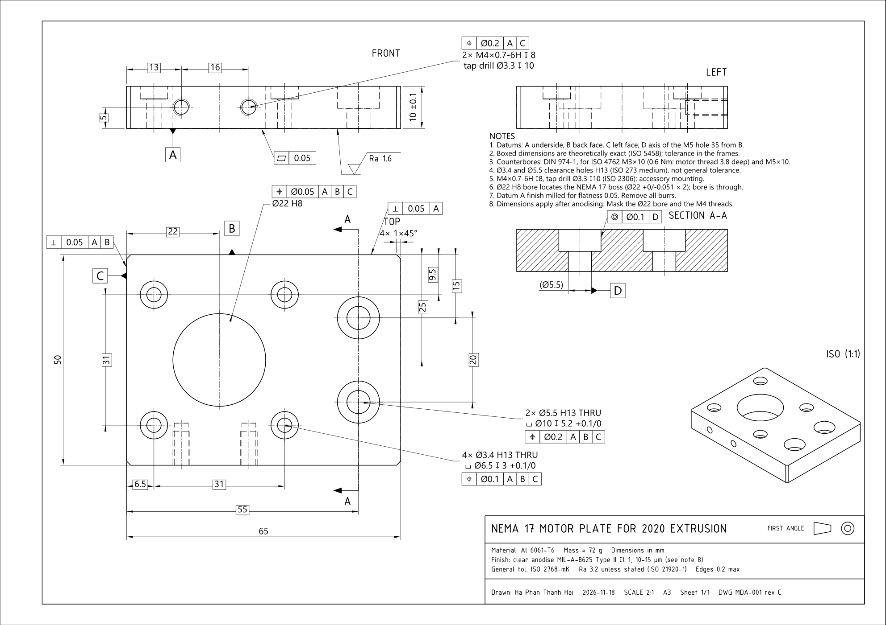
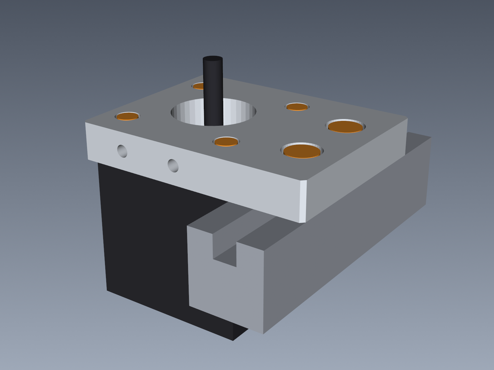

# mech-drawing-audit

A CNC-milled part, its ISO production drawing, and scripts that check the drawing against the 3D model and the part
against what it bolts to. The checks read the DXF itself, not a picture of it. The part is a plate that holds a
NEMA 17 stepper motor beside a 2020 aluminium extrusion.

| | |
|---|---|
| Part | 65 × 50 × 10 mm, Al 6061-T6, clear anodised. 1 × 45° chamfer on the 4 vertical corners |
| How it mounts | The motor face and the top of the extrusion both bear on the underside (datum A). The motor hangs below the left part of the plate with its shaft up through the pilot bore. The extrusion runs along y under the right part. All screws go in from the top, into counterbores. Nothing locates the plate on the extrusion in x or y: align the x = 65 edge with the side of the extrusion, and the screws hold it by friction |
| Features | Ø22 H8 pilot bore, which locates on the motor's Ø22 boss; 4 × M3 counterbored on the 31 mm NEMA 17 square, for ISO 4762 M3×10 tightened to 0.6 Nm; 2 × M5 counterbored on the extrusion's slot line, 20 apart, for ISO 4762 M5×10 into T-nuts; 2 × M4×0.7-6H tapped 8 deep in the front face, for accessories such as a limit-switch bracket |
| Drawing | A3, scale 2:1, first-angle projection, rev C. Front, top and left views, section A-A through the M5 holes, and an iso view at 1:1. 21 real DIMENSION entities, 8 GD&T frames, datums A–D, title block, ISO 2768-mK. The plate thickness (10 ±0.1) and the counterbore depths (+0.1/0) are toleranced, because the screw stack depends on them |

## Folders

| Path | What it is |
|---|---|
| `part/part.py` | the model. Every design value is at the top, with its source |
| `drawing/drawing.py`, `drawing/to_pdf.py` | the drawing, then its PDF and PNG |
| `verify/verify.py` | drawing ↔ model checks (20), with `verify/overlap.py` for text and leader legibility |
| `verify/fit.py` | assembly checks (7): plate, motor, extrusion and screws, with the worst-case screw stack |
| `verify/break_test.py` | damages copies of the outputs and confirms that the checks reject each one |
| `render/render.py` | shaded views of the part and the assembly |
| `deliver/` | what a shop or a reviewer gets, listed below |

`deliver/` contains:

- `part.step` and `assembly.step`;
- the drawing as `part.dxf`, `part.pdf` and `part.png`;
- `views.json`: each view's projection (origin, right and up vectors, scale);
- `dims.json`: each dimension's DXF handle, view, value and tolerance, and the 3D points it measures (`p1`/`p2`,
  or `at`/`axis` for a diameter or radius);
- `gdt.json`: each GD&T frame's DXF handle, content and the feature it controls;
- `features.json`: the design values;
- `render/`: the shaded views.

The check results are in `verify/report.json`, `verify/checks.json`, `verify/fit.json` and `verify/break_test.json`.

Run everything with `python run_all.py`. That Python needs build123d 0.13, ezdxf and vtk. The PDF step also needs
PyMuPDF. If PyMuPDF is in a different Python, set `PDF_PYTHON` to that interpreter.

## How the drawing is made

- The views are hidden-line projections of `part.step`. The drawing is then checked against the model.
- Every dimension is a DIMENSION entity, not loose lines and text. The sheet is at 2:1, so the dimension style
  sets DIMLFAC = 0.5 and the numbers read in true mm.
- Theoretically exact dimensions (ISO 5458) use their own dimension style, with a box around the number.
- GD&T frames are TOLERANCE entities on layer `GDT`. The PDF renderer does not draw TOLERANCE, so a line copy of each
  frame sits on layer `GDT_PDF`. That layer is off in the DXF and switched on only for the PDF.
- A frame that belongs to a size callout sits directly against the callout text. The other frames have a leader
  that ends in an arrowhead on the feature (ISO 1101).
- ezdxf sizes multi-line callout text from the raw string, which leaves a gap of up to 34 mm between the leader and
  the text. `drawing.py` moves each callout text to 1 mm past its leader shoulder, using the real font width.
- Datum D is the axis of one M5 hole. Its triangle sits in line with the hole's dimension line in section A-A
  (ISO 5459). That dimension is shown in brackets as auxiliary, because the hole size is already given in the top
  view.
- Threads seen end-on are drawn as ¾ circles on layer `THREAD`.
- The roughness symbol is the ISO 21920-1 graphical symbol: material removal required, with the requirement on the
  horizontal bar.
- Line widths are the ISO 128-20 pair 0.5 / 0.25.

## What the checks cover

`verify/verify.py` (drawing ↔ model):

1. `part.step` is one valid solid.
2. The DXF's DIMENSION entities and `dims.json` match one to one, and no dimension has been exploded into
   loose text.
3. Each dimension's measured geometry × DIMLFAC equals its `dims.json` value to 0.005 mm. The text shows that value,
   both in the rendered block and in any typed override.
4. Each dimension's defpoints are its `dims.json` 3D points projected through `views.json`, to 0.02 sheet mm.
5. Every linear dimension point lies on the STEP, either on a surface or on a hole axis. Every diameter and radius
   is a cylinder of the STEP with that axis.
6. Overall X, Y and Z are dimensioned.
7. Each drawn view matches a fresh hidden-line projection of the STEP to 0.05 mm, in both directions, so nothing is
   missing and nothing is extra.
8. Every hole has a size, a location given as theoretically exact dimensions, and a position frame.
9. The GD&T frames are TOLERANCE entities, and every datum letter they use has a datum symbol. Each frame sits near
   its feature, or directly under the size callout it controls.
10. No text touches a line, an arrow or another text. Text boxes come from the font metrics; the other entities,
    dimension blocks included, are sampled every 0.15 mm.
11. No leader crosses a dimension line, a GD&T frame, a datum box or a TED box. Leaders may cross extension lines
    and view geometry.
12. The title block has the author, scale, projection, material, general tolerance, "Dimensions in mm" and the sheet
    number, and the views are drawn at the title-block scale.

`verify/fit.py` builds the assembly from `features.json` and checks it:

- **Interference:** none between the plate, the motor, the extrusion and the six screws, apart from each M3 screw in
  its own motor thread.
- **Clearances:** the 42.7 mm motor body clears the extrusion by 1.65 mm, which must be at least 1, and lies inside
  the plate.
- **Screw stack, worst case:** floor = plate thickness (10 ±0.1) − counterbore depth (+0.1/0), and screw length
  ±0.29 (ISO 4759-1 grade A, js15).
  - M3×10 into the motor: engagement 2.61 / 3.00 / 3.49 mm (min / nominal / max). The maximum stays below the
    motor's 3.81 mm minimum thread depth, so the screw cannot bottom out.
  - The heads never stand proud: each counterbore is at least as deep as the head height k max (M3 0.0 mm spare,
    M5 0.2 mm).
  - M5×10: 4.81 / 5.20 / 5.69 mm below the plate, inside the 6 mm slot assumed for the extrusion.
- **Material under the screw heads:** the thinnest floor is 6.8 mm under the M3 heads and 4.6 mm under the M5 heads.
  The punch-through shear check is π · head diameter · floor · 207 MPa, against the preload from the tightening
  torque (0.6 Nm for M3, 4 Nm for M5) with K = 0.2. The capacity is 24 × the preload for M3 and 6.4 × for M5. This
  ratio covers the plate only, not the whole joint: the T-nut and the motor thread are separate limits (see Limits).

`verify/break_test.py` makes nine damaged copies and runs both scripts on each. All nine are rejected by the
check that should catch them:

- a dimension that shows 64 instead of 65;
- a dimension point moved 1 mm;
- `dims.json` pointing 0.5 mm off the part;
- a GD&T frame deleted;
- the pilot bore opened to Ø23 in the model while the drawing still says Ø22;
- a note moved onto the section view;
- the M5 position frame drawn across its own callout leader;
- the motor moved 3 mm towards the extrusion;
- the M5 counterbores deepened to leave 0.6 mm under the heads.

Two of these cases found gaps in the checks before they were added:

- The first version did not read typed dimension overrides.
- The first revision of the part left only 0.6 mm under the M5 heads, and nothing checked it.

## Design values and sources

- **NEMA 17 motor:** 31 mm square pattern (NEMA ICS 16). Pilot Ø22.0 +0/−0.051 × 2.0, body 42.7, and M3 thread
  depth 0.15 in (3.8 mm) minimum, per the Novanta IMS size 17 linear actuator data sheet, REV032022. That is a
  linear actuator on the same NEMA 17 frame. Other makers give up to 4.5 mm of thread, so check the motor you buy.
  The H8 bore gives 0 to 0.084 clearance on the boss, so the bore locates the motor.
- **Counterbores:** diameters from DIN 974-1 for ISO 4762 heads (M3 Ø6.5, M5 Ø10). The depths are chosen here from
  the screw stack: 3.0 +0.1/0 for M3 and 5.2 +0.1/0 for M5.
- **M3 tightening torque:** 0.6 Nm. The motor thread is only 3.8 mm deep, so the engagement is about 1 d, under
  the 1.5–2 d usually wanted in aluminium. The torque is kept low for that reason.
- **Clearance holes:** ISO 273 medium series, H13: 3.4 and 5.5.
- **M4 thread:** M4×0.7-6H, tap drill Ø3.3 (ISO 2306), thread 8 deep, drill 10 deep.
- **Material:** 6061-T6 shear strength 207 MPa, from the ASM Aerospace Specification Metals data sheet.
- **Screw length tolerance:** ISO 4759-1, product grade A: js15, ±0.29 mm for a 10 mm screw.

## Limits

- The interference checks use nominal dimensions. Only the screw stack is checked at the tolerance limits.
- The motor and the extrusion in `assembly.step` are envelopes, not vendor models. The extrusion is a 20 × 20 bar
  with a 6.2 × 6 slot on top. The T-nut and the slot lip thickness are not modelled, so the M5 thread engagement
  in the T-nut is not checked. With a lip of about 1.8 mm, the nominal M5×10 would engage about 3.4 mm of the nut,
  about 0.7 d. Check the T-nut and the slot of the extrusion you buy; an M5×12 adds 2 mm and may reach the slot
  floor.
- The screw checks cover the preload only, not operating loads.
- The STEP models the M4 holes at tap-drill size. The thread exists only on the drawing (callout and ¾ circles),
  which is the usual practice.
- The checks prove that the drawing and the model agree, and that the nominal parts do not collide. They do not prove that the frame
  values suit the motor or the extrusion; those values are design choices.
- The PDF is rendered from the DXF by ezdxf. Another CAD program may place dimension text slightly differently.
